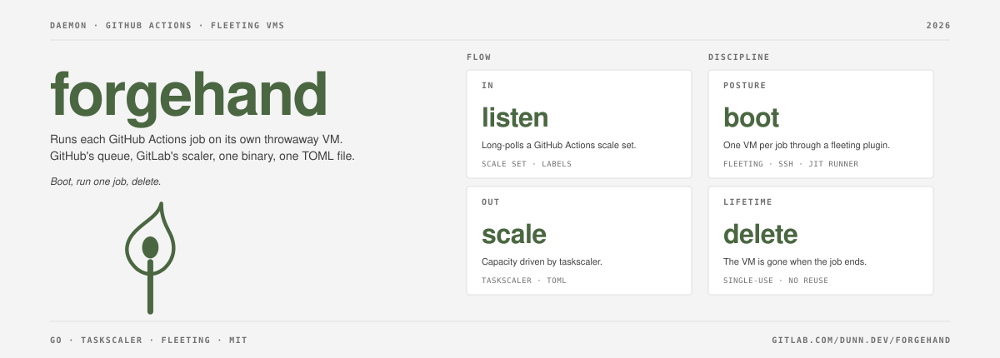

# forgehand

[](https://gitlab.com/dunn.dev/forgehand/-/pipelines)
[](LICENSE)


A daemon that runs each GitHub Actions job on a virtual machine made for that job alone.

forgehand listens to a GitHub Actions scale set as a GitHub App. For each job it
takes a fresh VM from a [fleeting](https://gitlab.com/gitlab-org/fleeting/fleeting)
plugin, starts a just-in-time runner on it over SSH, and releases the VM when the
job ends. [taskscaler](https://gitlab.com/gitlab-org/fleeting/taskscaler) drives
capacity, so most `[runners.autoscaler]` settings from gitlab-runner carry over
and any fleeting plugin should fit. `capacity_per_instance` and `max_use_count` are
rejected, because each VM runs one job.

## Status

Pre-release. The tests take one job end to end against fleeting's dummy plugin,
but forgehand has not yet run against real GitHub and a real VM. The
configuration schema is still changing.

## Prerequisites

- A GitHub App installed on the repository. Each scale set serves one
  repository, set as `url = "https://github.com/<owner>/<repo>"`, so N
  repositories need N scale sets. [Create the
  App](https://docs.github.com/en/apps/creating-github-apps/registering-a-github-app/registering-a-github-app)
  with the repository permission Administration read and write and the webhook
  off, then install it and generate a private key. `client_id` is the App's
  client ID, not its App ID; `installation_id` is the number at the end of the
  installation's settings URL. Do not point a scale set at a public repository
  whose fork pull requests can run without approval; see GitHub's
  [self-hosted runner security guidance](https://docs.github.com/en/actions/reference/security/secure-use#hardening-for-self-hosted-runners).
- A fleeting plugin for your hypervisor or cloud, installed on the host.
  [fleeting-plugin-libvirt](https://gitlab.com/dunn.dev/fleeting-plugin-libvirt) is the reference plugin.
- A guest image with:
  - POSIX `sh` and `setsid`
  - [actions/runner](https://github.com/actions/runner) unpacked at `runner.dir`, writable by `connector_config.username`
  - SSH reachable from the host as `connector_config.username`; the plugin
    generates the key pair itself. Set `use_static_credentials = true` with
    `key_path` (read at start; the example unit loads it as a systemd
    credential) to survive a daemon restart: the image must trust the matching
    public key, because nothing is seeded
  - `autoscaler.instance_ready_command` gates readiness: a VM takes a job only
    after it exits 0 over SSH, and the connection retries until `connector_config.timeout`.
    Set it (`true` suffices) unless the image brings SSH up before the plugin reports an address

## Scale set names

Every scale set name must be one path segment: not `.` or `..`, with no `/` or
`\` and no control characters. With static credentials the name is also the
scale set's state directory.

## Install

```
go install gitlab.com/dunn.dev/forgehand/cmd/forgehand@latest
```

Release binaries for linux amd64 and arm64 are on the
[releases page](https://gitlab.com/dunn.dev/forgehand/-/releases).

Or build from source with `mise install && just build`, which writes
`bin/forgehand`. Install a plugin with `fleeting-artifact install <ref>` and `FLEETING_PLUGIN_PATH`
set to the directory the unit sets (the plugin's README has its install line),
or set `plugin` to a binary path.

## Quickstart

```
curl -O https://gitlab.com/dunn.dev/forgehand/-/raw/main/examples/forgehand.toml
$EDITOR forgehand.toml
forgehand check -c forgehand.toml
forgehand run -c forgehand.toml
```

`check` resolves the plugin, finds the key files that are set and authenticates the App, then prints `ok`. It does not start the plugin; `plugin_config` is validated when `run` starts it. It creates nothing and starts no VM.
[`examples/forgehand.toml`](examples/forgehand.toml) comments each required key;
[`examples/forgehand.service`](examples/forgehand.service) is a hardened systemd unit.

Hardware is plugin config that forgehand passes through untouched: `tpm` and `pci_devices`
in `plugin_config`, one scale set per hardware class so `runs-on` selects it. A scale set with
`pci_devices` sets `max_instances` at most the number of addresses. `check` does not validate
`plugin_config`; a bad hardware key fails when `run` starts the plugin. The example config
shows both, and the [plugin README](https://gitlab.com/dunn.dev/fleeting-plugin-libvirt) defines the keys.

## Verify a release

Download a binary from the releases page and its `.bundle` from the package registry (`https://gitlab.com/api/v4/projects/dunn.dev%2Fforgehand/packages/generic/forgehand/<tag>/forgehand-linux-amd64.bundle`; substitute the platform), then:

```
cosign verify-blob forgehand-linux-amd64 --bundle forgehand-linux-amd64.bundle \
  --certificate-identity-regexp '^https://gitlab\.com/dunn\.dev/forgehand//\.gitlab-ci\.yml@refs/tags/.+$' \
  --certificate-oidc-issuer https://gitlab.com
```

## Signals

- `SIGQUIT` drains: idle runners are removed and running jobs finish before the
  daemon exits. `SIGTERM` or `SIGINT` during a drain ends it and stops within `shutdown_timeout`.
- `SIGUSR1` hands off, only when every scale set sets `use_static_credentials`
  (otherwise it is ignored and logged as an error): idle runners are removed,
  nothing new starts, and once no runner is waiting for a VM, starting,
  listening, being removed or being adopted, and the VMs of the removed
  runners are deleted, the daemon exits 0 without
  deleting the VMs of running jobs. During a drain or a handoff only
  `SIGTERM` and `SIGINT` act; `SIGQUIT` and `SIGUSR1` are logged and ignored.
  To stop a handoff early, send SIGTERM (`systemctl kill --kill-whom=main -s SIGTERM forgehand`);
  that stops running jobs.
  A tripped failure breaker during a handoff exits 1 and still leaves the VMs
  of running jobs. `SIGUSR1` during startup is dropped: send it again once
  every scale set has started. See Upgrade.
- `SIGTERM` and `SIGINT` stop within `shutdown_timeout` seconds, running jobs
  included.
- A crash (`SIGKILL`) leaves the VMs and their runners running; see Restart.

## Restart

With `use_static_credentials = true`, forgehand keeps its autoscaler state in
`$STATE_DIRECTORY/<scale set name>` (the example unit sets
`StateDirectory=forgehand`). `run` refuses to start without `STATE_DIRECTORY`
when a scale set uses them. A restart adopts what an earlier run left:

- A VM whose runner is running a job keeps running; the new process follows
  the runner and holds the VM until GitHub reports the job complete.
  A runner that has already exited leaves the VM held the same way, and GitHub
  is asked about it every 30 seconds.
- A VM whose runner is idle or has not taken its job is deleted, and its
  runner is removed. GitHub offers a job assigned to it again to a new VM.
- A VM held warm by `idle_count` stays.
- Nothing starts a new VM for a job until the restored VMs have been counted.
  That wait ends at once when none are restorable, and after 3 minutes at most.
- `SIGTERM` during that wait deletes every VM but removes only the runners of
  slots already adopted; the others stay registered.

The state files hold no JIT config, but they hold each VM's connection
details, including the guest SSH private key. They are mode 0600 in a 0700
directory, readable only by the service user and root.

Without static credentials the plugin generates the guest key itself, and a
restart cannot reach the VMs an earlier run left. They are deleted and their
runners removed, and any job they ran is lost.

## Upgrade

With `use_static_credentials = true` on every scale set, a running job survives
an upgrade:

```
systemctl kill --kill-whom=main -s SIGUSR1 forgehand
# wait for the service to exit
# replace the binary
systemctl start forgehand
```

The old process removes idle runners and exits once the VMs of the removed runners are deleted, leaving the VMs of
running jobs for the new one to adopt as in Restart. `--kill-whom=main` keeps the signal off
the plugin child. With generated credentials `SIGUSR1` is ignored: drain with
`SIGQUIT` (`systemctl stop`) and wait for the jobs instead.

## Instance health

A failed pre-acquire heartbeat removes the instance at once; `failure_threshold` does not govern that.

## Metrics

With `listen_address` set, forgehand serves Prometheus `/metrics` there. The
endpoint has no authentication, so bind it to loopback or firewall it.

## Contributing

Issues and merge requests go to [GitLab](https://gitlab.com/dunn.dev/forgehand).
See [CONTRIBUTING.md](CONTRIBUTING.md); report vulnerabilities as
[SECURITY.md](SECURITY.md) describes.

## License

[MIT](LICENSE).

Built by Andrew Dunn, 2026.
